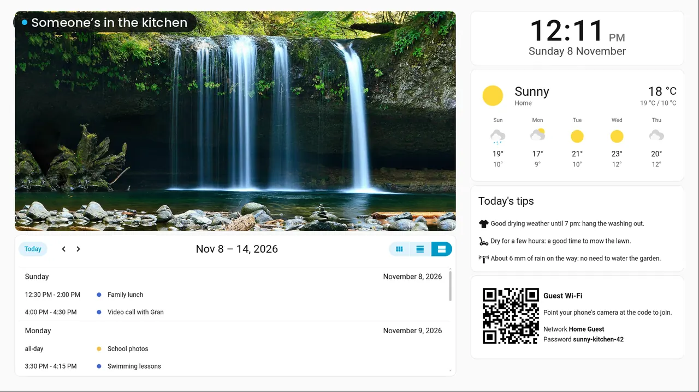

# A kitchen screen that turns into a photo frame



While someone is in the kitchen, the screen shows a family board: photos, this week's
calendar, the weather with tips for the washing and the lawn, and a QR code for the guest
Wi-Fi. Once nobody has been there for five minutes, it shows only photos, like a
screensaver. A presence sensor switches between the two dashboards.

You need:

- PleatView on a screen in the kitchen: a mini PC or a Raspberry Pi with a monitor, a tablet
  or a TV.
- A presence sensor in the kitchen. An mmWave sensor notices people standing still, so the
  board stays up while you cook. A motion sensor doesn't.
- A weather integration with an hourly forecast. Met.no, which Home Assistant adds for your
  home when you set it up, has one: `weather.forecast_home`.
- A calendar, and some photos.

Change the entity names below to yours. Everything here is plain Home Assistant: no custom
cards.

## 1. Photos

Since March 2025, Google lets apps read only the photos they uploaded themselves, so Home
Assistant's Google Photos integration can't show your albums. Two ways that work:

- **A shared Google Photos album**, with [Album Slideshow](https://github.com/eyalgal/album_slideshow)
  from HACS. It turns the album into a camera entity that moves to the next photo by itself.
  Use that camera instead of `image.kitchen_photos` below.
- **A folder of photos**, which is what our demo uses. Put them in `/config/www/photos/` as
  `01.jpg`, `02.jpg` and so on, and add this to `configuration.yaml` (change the 10 to the
  number of photos):

```yaml
template:
  - triggers:
      - trigger: time_pattern
        seconds: "/30"
    image:
      - name: Kitchen photos
        url: "http://127.0.0.1:8123/local/photos/{{ '%02d' % ((now().timestamp() // 30) | int % 10 + 1) }}.jpg"
```

If Home Assistant has its own certificate, start the address with `https` and add
`verify_ssl: false` under `url`.

## 2. Weather tips

This template sensor reads the hourly forecast every 15 minutes and turns it into three
tips: when to hang the washing out, whether it's a good time to mow, and whether the garden
needs water. Add it to `configuration.yaml` too:

```yaml
template:
  - triggers:
      - trigger: time_pattern
        minutes: "/15"
      - trigger: homeassistant
        event: start
      - trigger: state
        entity_id: sun.sun
    actions:
      - action: weather.get_forecasts
        target:
          entity_id: weather.forecast_home
        data:
          type: hourly
        response_variable: forecast
      - variables:
          tips: >-
            
            
            
            
              
              
                
              
              
              
            
            {% set until = (as_datetime(ns.rain_at) | as_local).strftime('%-I %p') | lower if ns.rain_at else none %}
            
            
              
            
              
            
              
            
              
            
            
              
            
              
            
              
            
            
              
            
              
            
              
            
              
            
            {{ [{'icon': 'mdi:tshirt-crew', 'text': washing}, {'icon': 'mdi:mower', 'text': lawn},
                {'icon': 'mdi:sprinkler-variant', 'text': water}] }}
    sensor:
      - name: Kitchen weather tips
        icon: mdi:lightbulb-on-outline
        state: "{{ tips[0].text[:250] }}"
        attributes:
          tips: "{{ tips }}"
```

If you already have a `template:` section, add both list items to it instead of a second
`template:`. Restart Home Assistant (or reload template entities) after editing.

## 3. Guest Wi-Fi QR code

A phone joins a network from a QR code holding `WIFI:T:WPA;S:<network>;P:<password>;;`.
Make a picture of it with any QR code maker, for example
`qrencode -o guest-wifi.png 'WIFI:T:WPA;S:Home Guest;P:your-password;;'`, and copy it to
`/config/www/guest-wifi.png`. Some router integrations, such as UniFi Network and FRITZ!Box
Tools, already have the code as an image entity.

Use your guest network: everyone in the kitchen can read the password.

## 4. The two dashboards

In Settings → Dashboards, add two dashboards from scratch: **Kitchen** with the address
`dashboard-kitchen` and **Photo frame** with `dashboard-photos`. Open each, choose the pencil,
then ⋮ → Raw configuration editor, and paste.

The family board:

```yaml
views:
  - title: Kitchen
    type: sections
    max_columns: 3
    dense_section_placement: true
    sections:
      - type: grid
        column_span: 2
        cards:
          - type: picture-entity
            entity: image.kitchen_photos
            show_name: false
            show_state: false
            aspect_ratio: "2:1"
            tap_action:
              action: none
            grid_options:
              columns: full
          - type: calendar
            entities:
              - calendar.family
              - calendar.school
            initial_view: listWeek
            grid_options:
              columns: full
              rows: 5
      - type: grid
        cards:
          - type: clock
            clock_size: large
            date_format: [weekday-long, day-numeric, month-long]
            grid_options:
              columns: full
              rows: 2
          - type: weather-forecast
            entity: weather.forecast_home
            name: Home
            forecast_type: daily
            show_current: true
            show_forecast: true
            grid_options:
              columns: full
          - type: markdown
            title: Today's tips
            content: |-
              
              <ha-icon icon="{{ tip.icon }}"></ha-icon> {{ tip.text }}

              
            grid_options:
              columns: full
          - type: markdown
            content: |-
              <table role="presentation" border="0"><tr><td></td><td>

              ### Guest Wi-Fi
              Point your phone's camera at the code to join.

              Network **Home Guest**<br>Password **your-password**
              </td></tr></table>
            grid_options:
              columns: full
```

The photo frame:

```yaml
views:
  - title: Photos
    panel: true
    cards:
      - type: picture-entity
        entity: image.kitchen_photos
        show_name: false
        show_state: false
        tap_action:
          action: none
```

## 5. The automation

Settings → Automations & scenes → Create automation → ⋮ → Edit in YAML:

```yaml
alias: "Kitchen display: photos when nobody's around"
triggers:
  - trigger: state
    entity_id: binary_sensor.kitchen_presence
    to: "off"
    for: "00:05:00"
  - trigger: state
    entity_id: binary_sensor.kitchen_presence
    to: "on"
actions:
  - action: pleatview.show_dashboard
    target:
      entity_id: media_player.kitchen_display
    data:
      path: "{{ '/dashboard-kitchen' if trigger.to_state.state == 'on' else '/dashboard-photos' }}"
```

## 6. PleatView's options

In Settings → Devices & services → PleatView → Configure on the kitchen screen, set
**Home dashboard** to `/dashboard-kitchen`, so the board is back after a restart. A **Zoom**
of 125 % makes a 1080p screen easy to read from across the kitchen. That's what the demo uses.

The photos in our demo are CC0 pictures from Wikimedia Commons, and its forecast is made up.
