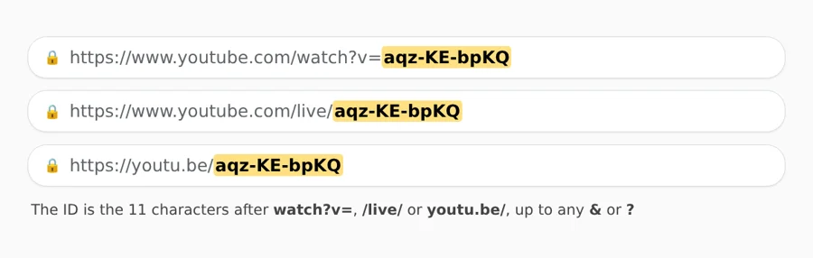
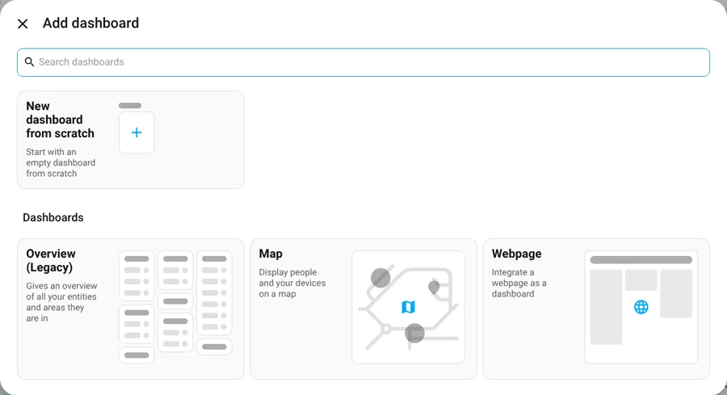
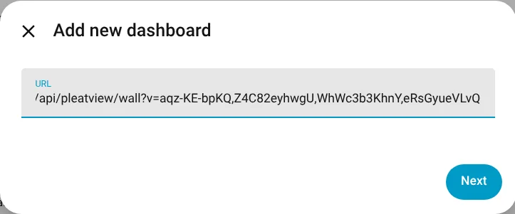
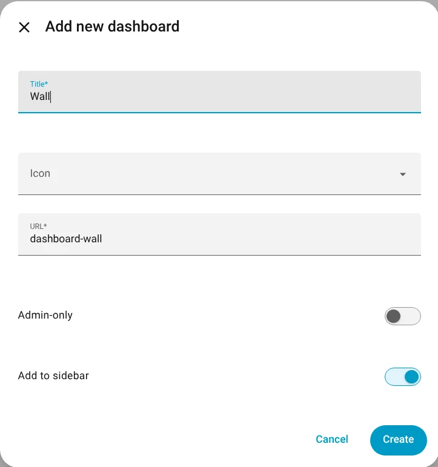
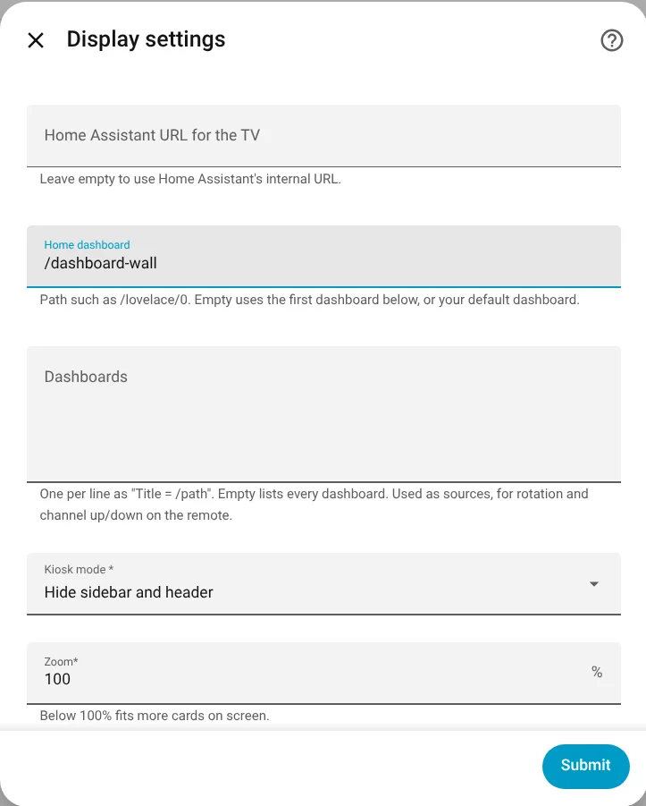
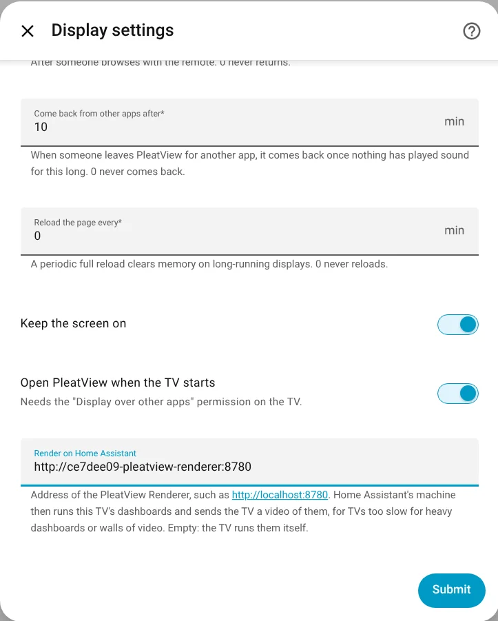

# A wall of live streams


YouTube live streams on one TV, muted, all day: station cams, a city skyline, the space
station, the news. Your own Home Assistant serves the wall, at an address that lists the
streams, in a grid that fits however many you list: one fills the screen, four make two rows
of two, nine three of three.

```
/api/pleatview/wall?v=ID,ID,ID,ID
```

There's no file to copy and nothing runs outside your home except the players themselves,
which come from YouTube's privacy-enhanced mode. It takes the PleatView integration 1.0.15
or later. The TV app (1.0.15 and later) builds the wall itself, each row in a process of
its own; other screens, such as the Linux app or a browser, show the same page.

## 1. Find your streams' IDs



Open each stream on YouTube. Its ID is the 11 characters after `watch?v=`, `/live/` or
`youtu.be/`, up to any `&` or `?`. When a live stream restarts, it can get a new ID: put the
new one in the address. The stream has to allow embedding; most live cams do.

## 2. Make a Webpage dashboard

In Home Assistant, *Settings → Dashboards → Add dashboard*, and pick **Webpage**.



For the URL, put `/api/pleatview/wall?v=` followed by your streams' IDs, separated by
commas, up to 16. Then *Next*.



Give it a title, such as *Wall*. Home Assistant makes the dashboard's address from it,
`dashboard-wall`, which you need in the next step. Then *Create*.



The dashboard already shows the wall in your browser.

YouTube addresses in webpage cards don't play: Home Assistant's pages send no referrer,
and YouTube refuses embedded players without one (*Error 153: Video player configuration
error*). The wall's page sends one for each player.

## 3. Put it on the TV

*Settings → Devices & services → PleatView*, and the gear next to the TV. Put the
dashboard's address in **Home dashboard**, here `/dashboard-wall`, and *Submit*. The TV
switches to the wall and comes back to it after anything else.




Or show it for a while from an automation, and keep your usual home dashboard:

```yaml
actions:
  - action: pleatview.show_dashboard
    target:
      entity_id: media_player.living_room_tv
    data:
      path: /dashboard-wall
      duration: 600
```

## 4. More than a few streams

Every stream is a YouTube player that the TV runs and decodes, and a streaming stick
manages only a few. What we measured, with nine live streams of Amsterdam's station cams
and others like them:

| TV | Streams | Result |
| --- | --- | --- |
| Fire TV Stick (3rd gen, 1 GB), zoom 100 % | 4 | 360p and 480p, all playing; about one frame in four dropped |
| Fire TV Stick (3rd gen, 1 GB) | 9 | Too many: the stick runs out of memory |
| Chromecast with Google TV (HD), zoom 67 %, one page | 9 | Buffering most of the time |
| Chromecast with Google TV (HD), zoom 67 %, the TV app's wall | 9 | Playing about two thirds of the time, most frames dropped |
| Both, **rendered on Home Assistant** | 9 | Every stream moving, about 3 seconds behind live |

On the TV itself, keep a wall to about four streams. For more, let
[Home Assistant render it](../render-on-home-assistant.md): its machine runs the players
and sends the TV one video, which any TV plays smoothly. Once the PleatView Renderer is
installed, it's one setting at the bottom of the same dialog:



YouTube picks each player's quality from its size on the screen. PleatView's **Zoom**, in
the same dialog, makes the players larger in YouTube's eyes: at 67 %, each quarter of a
1080p screen asks for 720p instead of 480p. Sharper, but more for the TV to decode.

YouTube remembers a device that dropped frames, and used to keep it at low quality for a
month, even once it would play well. From 1.0.14, PleatView has every player start afresh,
so a struggle on one day doesn't leave the wall blurry the next.

PleatView 1.0.14 put walls at an address on pleatview.hustlesman.com. The TV app still
understands that address, but the one on Home Assistant keeps everything on your network.

The pictures show four of the Blender Foundation's open movies standing in for live
streams: Big Buck Bunny, Caminandes: Gran Dillama, Spring and Sintel (CC BY).
