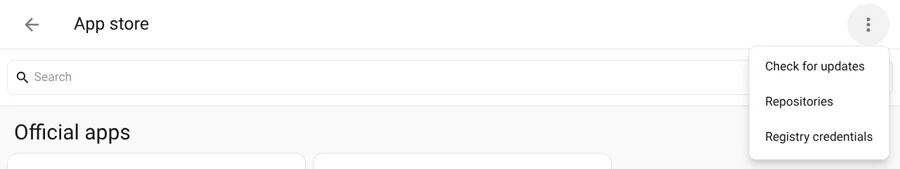
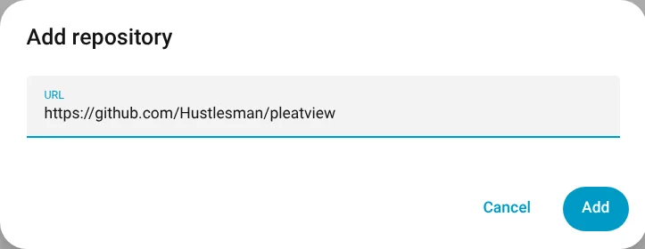
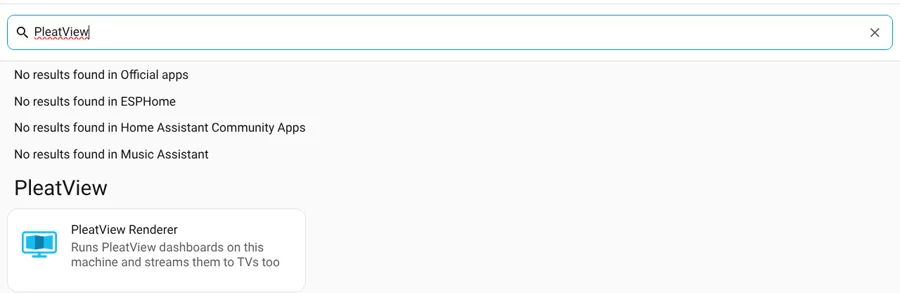
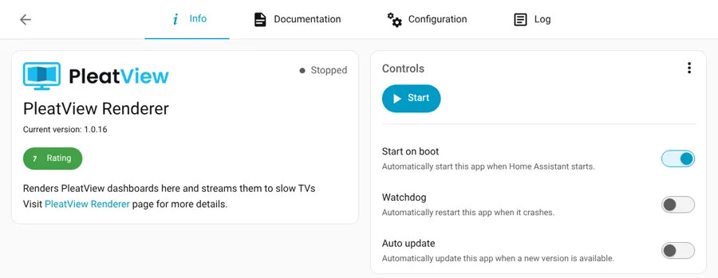
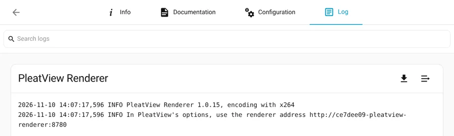
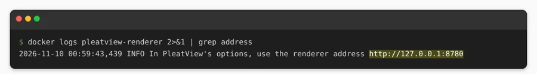
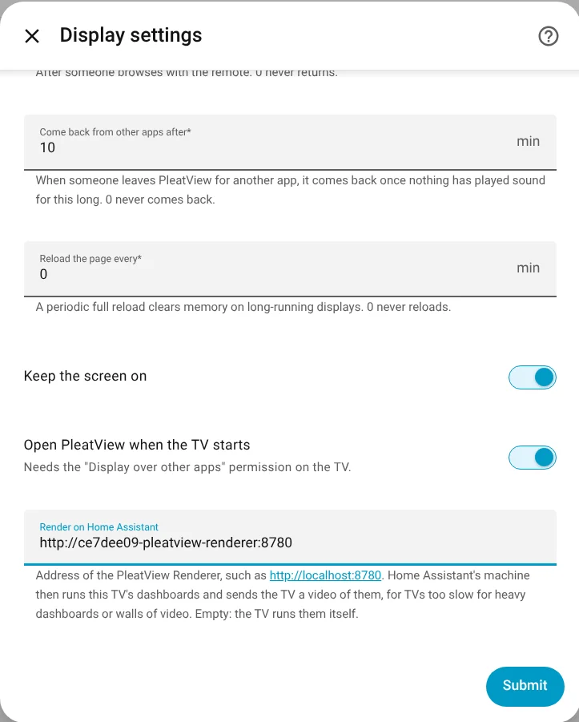

# Render on Home Assistant

Some dashboards are too much for a TV: a wall of nine YouTube live streams, or a heavy
dashboard on a cheap streaming stick. The machine that runs Home Assistant is often far
stronger. With the **PleatView Renderer**, that machine runs the TV's dashboards in a
browser of its own and sends the TV one H.264 video of them, which every TV plays in
hardware without effort.

What we measured on a Chromecast with Google TV (HD), with nine YouTube live streams:

| | On the TV itself | Rendered on Home Assistant |
| --- | --- | --- |
| Playback | Buffering most of the time | Every stream moving, about 3 seconds behind live |
| The TV's processor | Busy with nine players | PleatView at about 40 % of one core |
| Network | Nine YouTube streams | One stream of about 3 to 4 Mbit/s |

The Home Assistant machine, an Intel Core i5-7500 with Quick Sync, used about 2.5 of its
4 cores and 1.2 GB of memory for that wall. A dashboard without video needs far less.

## What you need

- **PleatView on the TV**: Android TV, Google TV, Fire TV, or a phone or tablet with 1.0.14
  or later; the Linux app (mini PCs and Raspberry Pis) with 1.0.17 or later. For the
  smallest boards, such as a Raspberry Pi Zero 2 W, [PleatView Light](../light/README.md)
  plays only the rendered stream, with the board's video decoder.
- **A Home Assistant machine with power to spare.** A mini PC or a NAS with an Intel or
  AMD processor is ideal, and its graphics encode the video. A Raspberry Pi 4 or 5 manages
  ordinary dashboards, not walls of video.
- **The TV's sign-in managed by Home Assistant**, which is the default when you add a TV.
  The renderer signs in as the TV's own Home Assistant user.

## 1. Install the renderer

Pick the way that matches your Home Assistant. On **Home Assistant OS** or Supervised, which
most installs are, the renderer is an app, as below. On **Home Assistant Container**, use the
alternative at the end of this step instead.

Home Assistant 2026 calls add-ons *apps*. On older versions, read *Add-ons* and *Add-on
store* below.

In *Settings → Apps*, choose *Install app*. In the App store, open the menu at the top
right and choose **Repositories**.



*Add*, and enter `https://github.com/Hustlesman/pleatview`.



Back in the App store, search for *PleatView* and open **PleatView Renderer**.



*Install*. Home Assistant builds the renderer on your machine, from the source in this
repository, which takes a few minutes. Then *Start*.



Its *Log* shows the address to use in PleatView. Added as above, the repository gives every
Home Assistant the same one: `http://ce7dee09-pleatview-renderer:8780`.



<details>
<summary><b>Alternative: Home Assistant Container</b> (Home Assistant in Docker, without the App store)</summary>

Build the renderer from source and run it on the same machine:

```sh
docker build -t pleatview-renderer https://github.com/Hustlesman/pleatview.git#v1.0.19:renderer
docker run -d --name pleatview-renderer --restart unless-stopped --network host \
  -e HOST=127.0.0.1 --device /dev/dri pleatview-renderer
```

Its address is then `http://127.0.0.1:8780`. Leave out
`--device /dev/dri` on a machine without Intel or AMD graphics; the processor encodes
instead, using about one core per TV.



</details>

<details>
<summary><b>Another machine:</b> a renderer for many TVs, or near them</summary>

A renderer can run on any Linux machine with Docker, such as a mini PC in a rack. On the
network it lets in only the Home Assistants (and other controllers) paired with it:

```sh
docker build -t pleatview-renderer https://github.com/Hustlesman/pleatview.git#main:renderer
docker run -d --name pleatview-renderer --restart unless-stopped --network host \
  -e HOST=0.0.0.0 -e NAME="Rack A" -v pleatview-renderer:/data --device /dev/dri pleatview-renderer
```

It announces itself, so Home Assistant shows it under *Settings → Devices & services* as a
discovered PleatView device. Give it a name and enter the PIN from its log
(`docker logs pleatview-renderer`). It then appears as a device of its own, with sensors for
its screens in use, its processor load and its memory, so you can see when to add another.
The volume keeps its pairings across restarts. On the network it serves HTTPS with a
certificate it makes for itself (its fingerprint is in the log), which Home Assistant pins
when pairing; give it your own with `-e TLS_CERT=/data/cert.pem -e TLS_KEY=/data/key.pem`.

</details>

## 2. Turn it on for a TV

*Settings → Devices & services → PleatView*, and the gear next to the TV. At the bottom,
choose the renderer in **Render on Home Assistant**, and *Submit*. The list shows paired
renderers by name, *Automatic* (the least busy of them, kept until it goes away), and the
renderers Home Assistant found by itself; you can also type a renderer's address there.



Only that TV changes; every other TV still runs its own dashboards. Empty the field to go
back.

## What changes on the TV


- Dashboards, rotation, the channel keys on the remote, `show_dashboard` and Home work as
  before: the renderer follows whatever the TV would show, at the TV's size, zoom and kiosk
  mode.
- The picture is about three seconds behind. A light switched on shows on the dashboard
  three seconds later.
- A screen hung on its side or upside down: set *Screen mounted* in its settings (portrait,
  turned clockwise or anticlockwise, or upside down). For PleatView Light, which only plays
  the stream, the renderer draws the dashboard upright and turns the picture, and Light
  turns its own text. The Linux app turns its whole screen itself. Android TVs ignore it.
- The TV only shows the picture. Browsing inside a dashboard with the remote, and the sign-in
  questions of webpage dashboards, don't reach the page.
- The dashboards' sound comes with the picture: a video or a camera with sound on a
  dashboard plays through the TV, as when the TV runs the page itself. The TV needs PleatView
  1.0.18 or later; older versions play the stream silently.
- Notifications, cameras in a corner, media and announcements still play on the TV itself.
  On [PleatView Light](../light/README.md), which only plays the stream, Home Assistant draws
  notifications and cameras into the stream instead.
- When the TV is off or in another app, the renderer stops its screen after 90 seconds and
  starts it again when the TV is back.
- Pages drawn with WebGL, such as 3D maps and Windy, are drawn by the processor: the
  renderer's browser has no graphics chip (the chip only encodes the video). They can be
  heavy. Radware's live threat map takes about three cores of an Intel Core i5-7500 and moves
  at about ten frames a second.

## Clicks and drags after a page loads

Pages the renderer draws take [page steps](page-steps.md) too: clicks on a button's text or
a CSS selector, clicks at a place, drags and scrolls, added to the page's address after
`#pleatview=`, to clear a cookie banner, close a pop-up or turn a map. For example, Radware's
live threat map with its side bar collapsed and the map turned:

```text
https://livethreatmap.radware.com/#pleatview=wait:5;click:Collapse;wait:2;drag:80,65,45,43;wait:2;click:Reject all
```

The renderer draws the page at the TV's size and density, so the steps press the same places
they would on the TV.

## Privacy and security

- Everything stays on your network. The renderer sends the stream to Home Assistant, which
  passes it to the TV at an address that includes a secret only that TV gets.
- The renderer's own interface has no sign-in, so it must not be reachable from the
  network: the app is only on Home Assistant's internal network, and the `docker run`
  above listens on 127.0.0.1 only.
- The pages' sound goes nowhere but the stream: the renderer has no sound card, and each
  screen's Chromium plays into a pipe that only the renderer reads.
- Chromium, which shows the pages, runs as an unprivileged user. It draws WebGL with Mesa's
  software renderer, which Chromium refuses for browsing at large; the renderer allows it
  because it shows only the pages you choose.
- The renderer is free software from Debian's main archive (Chromium, Xvfb, ffmpeg, Python's
  aiohttp, tini, the Mesa and Intel VA-API drivers and two font packages) on a pinned Debian
  12 base image. `http://<renderer>/api/packages` lists every installed package and version,
  for audits and vulnerability scans.

## Walls of live streams

Rendered on Home Assistant, a [wall of live streams](ideas/live-streams.md) plays on any
TV, however slow: the TV decodes one video, not nine.
